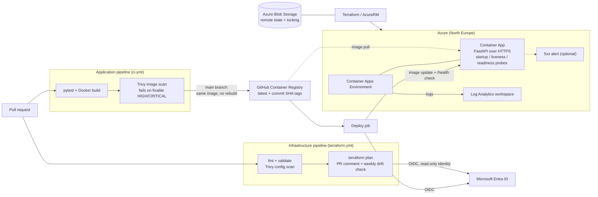

# Azure Container Platform

[](https://github.com/IgnasTamosaitis/azure-container-platform/actions/workflows/ci.yml)

A small FastAPI service deployed to **Azure Container Apps** using **Terraform** and **GitHub Actions**. The API is intentionally simple; this project focuses on infrastructure provisioning, container delivery, workload identity, and repeatable deployments.

## Architecture



Pull requests run both pipelines as required status checks. Publishing, deployment and `terraform plan` only run when their repository variables are enabled.

### Infrastructure and delivery

| Area | Implementation |
| --- | --- |
| Infrastructure | Terraform (AzureRM 5.x); resource group, Log Analytics workspace, Container Apps environment, and Container App |
| Runtime | Azure Container Apps Consumption, North Europe; 0.25 vCPU / 0.5 GiB, 0–1 replicas |
| Application | Python 3.12, FastAPI, Uvicorn; `/`, `/health`, and Swagger UI at `/docs` |
| Container | Python slim base image, non-root runtime user (UID 10001) |
| CI | `pytest` and a Docker build on pushes and PRs; Trivy scans the image and fails on fixable HIGH/CRITICAL CVEs |
| IaC checks | On PRs: `terraform fmt`, `validate`, Trivy misconfiguration scan, and a `terraform plan` posted as a PR comment |
| Drift | Weekly scheduled `terraform plan`; the workflow fails if live Azure resources differ from code |
| Observability | Log Analytics workspace (30-day retention, 0.5 GB/day cap); startup, liveness and readiness probes on `/health`; optional 5xx email alert |
| Supply chain | Hash-locked Python dependencies, third-party actions pinned to commit SHAs, Dependabot with a 14-day cooldown |
| Release | On `main`, push the exact image that was tested and scanned to GHCR (`latest` + commit-SHA tags), then deploy the SHA-tagged image |
| Identity | GitHub OIDC federation to Entra ID; a deploy identity scoped to the app resource group and a separate read-only identity for `terraform plan` |
| State | Separate Azure Blob backend with Entra ID access, state locking, versioning, and soft delete |

The application pipeline is defined in [`.github/workflows/ci.yml`](.github/workflows/ci.yml) and the infrastructure pipeline in [`.github/workflows/terraform.yml`](.github/workflows/terraform.yml). It verifies the deployed image reference and calls the application's `/health` endpoint after deployment. README-only pushes are ignored. Container publishing and Azure deployment are enabled only when the repository variable `DEPLOY_ENABLED` is set to `true`; otherwise CI runs without releasing.

**Ownership boundary:** Terraform manages the Azure resources and their configuration; GitHub Actions updates the application image. The Terraform resource uses a narrowly scoped `ignore_changes` rule for the image field to prevent deployment-induced drift.

## Run locally

Requires Python 3.12 and, for the container example, Docker.

```bash
python3 -m venv .venv
source .venv/bin/activate
python -m pip install -r requirements-dev.txt
python -m pytest -v
uvicorn app.main:app --host 127.0.0.1 --port 8080
```

Alternatively, build and run the container:

```bash
docker build -t azure-container-api:local .
docker run --rm -p 127.0.0.1:8081:8080 azure-container-api:local
```

From another terminal, check `curl http://127.0.0.1:8081/health`. The expected response is `{"status":"healthy"}`.

## Deploy to Azure

The infrastructure lives in [`terraform/`](terraform/). It expects an **existing** Azure Storage backend (configured in [`providers.tf`](terraform/providers.tf)) and appropriate Entra ID / Azure RBAC access. The state storage account is bootstrapped separately, not created by this Terraform configuration.

For a local Terraform run:

```bash
az login
export ARM_SUBSCRIPTION_ID="$(az account show --query id -o tsv | tr -d '\r\n')"
cd terraform
terraform init
terraform fmt -check
terraform validate
terraform plan
```

AzureRM 5.x no longer registers Azure resource providers automatically. In a subscription that has not used these services before, register them once before the first apply:

```bash
az provider register --namespace Microsoft.App
az provider register --namespace Microsoft.OperationalInsights
az provider register --namespace Microsoft.Insights
```

Review the plan before running `terraform apply`. The application URL is available from `terraform output -raw app_url` after deployment.

For automated releases, the GitHub repository requires `AZURE_CLIENT_ID`, `AZURE_TENANT_ID`, and `AZURE_SUBSCRIPTION_ID` Actions variables, an Entra federated credential trusted for the repository's `main` branch, and deployment permissions on the target resource group. Azure access uses short-lived OIDC tokens rather than a stored client secret.

## Verification and trade-offs

An end-to-end change to the API response was committed, tested, published to GHCR, and deployed through GitHub Actions. The public endpoint returned the updated response, and a subsequent `terraform plan` reported **no changes**.

This is a **portfolio reference implementation**, not a production-ready service. Known trade-offs:

- Scale-to-zero reduces idle compute usage but may introduce cold starts; Azure resources, Log Analytics ingestion and the separate state storage can still incur charges.
- The Trivy scans gate on fixable HIGH/CRITICAL findings only; any accepted risk is documented in `.trivyignore` with a reason rather than silently skipped.
- Deployment includes probes, a post-deploy health check and an optional 5xx alert, but not traffic-split rollouts or automated rollback.
- The base image is referenced by tag; pinning it to a digest is the next step towards fully reproducible builds.

### Pipeline identities

`terraform plan` runs under its own Entra ID app registration, so pull requests never hold write access to Azure resources. It needs:

- **Reader** on `rg-container-platform-dev`, to refresh existing resources.
- **Storage Blob Data Contributor** on the `tfstate` container, to read state and take the state lock.
- Federated credentials for the subjects `repo:<owner>/azure-container-platform:pull_request` and `repo:<owner>/azure-container-platform:ref:refs/heads/main`.

Repository variables: `AZURE_PLAN_CLIENT_ID` (plan identity), `AZURE_CLIENT_ID` (deploy identity), `AZURE_TENANT_ID`, `AZURE_SUBSCRIPTION_ID`, and optionally `ALERT_EMAIL`.

Both Azure-facing stages are opt-in, so the repository stays green while the environment is torn down: `DEPLOY_ENABLED=true` enables publishing and deployment, and `TF_PLAN_ENABLED=true` enables `terraform plan` and the weekly drift check. Tests, image scanning, `fmt`, `validate` and the Terraform misconfiguration scan always run and need no Azure access.

**Cleanup:** Leave `DEPLOY_ENABLED` and `TF_PLAN_ENABLED` unset (or set them to `false`) to prevent deployments and plan runs after teardown. Run `terraform plan -destroy` and review it before `terraform destroy`. The separately managed remote-state Storage Account is **not** deleted by that command. Provision the remote-state backend and application environment again before re-enabling releases.
