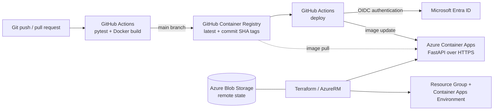

# Azure Container Platform

[](https://github.com/IgnasTamosaitis/azure-container-platform/actions/workflows/ci.yml)

A small FastAPI service deployed to **Azure Container Apps** using **Terraform** and **GitHub Actions**. The API is intentionally simple; this project focuses on infrastructure provisioning, container delivery, workload identity, and repeatable deployments.

## Architecture



### Infrastructure and delivery

| Area | Implementation |
| --- | --- |
| Infrastructure | Terraform (AzureRM 4.x); resource group, Container Apps environment, and Container App |
| Runtime | Azure Container Apps Consumption, North Europe; 0.25 vCPU / 0.5 GiB, 0–1 replicas |
| Application | Python 3.12, FastAPI, Uvicorn; `/`, `/health`, and Swagger UI at `/docs` |
| Container | Python slim base image, non-root runtime user (UID 10001) |
| CI | GitHub Actions runs `pytest` and a Docker build for pushes and pull requests |
| Release | On `main`, publish to GHCR with `latest` and commit-SHA tags, then deploy the SHA-tagged image |
| Identity | GitHub OIDC federation to Microsoft Entra ID; Azure RBAC scoped to the application resource group |
| State | Separate Azure Blob backend with Entra ID access, state locking, versioning, and soft delete |

The pipeline is defined in [`.github/workflows/ci.yml`](.github/workflows/ci.yml). It verifies the deployed image reference and calls the application's `/health` endpoint after deployment. README-only pushes are excluded from the release workflow.

**Ownership boundary:** Terraform manages the Azure resources and their configuration; GitHub Actions updates the application image. The Terraform resource uses a narrowly scoped `ignore_changes` rule for the image field to prevent deployment-induced drift.

## Run locally

Requires Python 3.12 and, for the container example, Docker.

```bash
python3 -m venv .venv
source .venv/bin/activate
python -m pip install -r requirements-dev.txt
python -m pytest -v
uvicorn app.main:app --host 127.0.0.1 --port 8080
```

Alternatively, build and run the container:

```bash
docker build -t azure-container-api:local .
docker run --rm -p 127.0.0.1:8081:8080 azure-container-api:local
```

From another terminal, check `curl http://127.0.0.1:8081/health`. The expected response is `{"status":"healthy"}`.

## Deploy to Azure

The infrastructure lives in [`terraform/`](terraform/). It expects an **existing** Azure Storage backend (configured in [`providers.tf`](terraform/providers.tf)) and appropriate Entra ID / Azure RBAC access. The state storage account is bootstrapped separately, not created by this Terraform configuration.

For a local Terraform run:

```bash
az login
export ARM_SUBSCRIPTION_ID="$(az account show --query id -o tsv | tr -d '\r\n')"
cd terraform
terraform init
terraform fmt -check
terraform validate
terraform plan
```

Review the plan before running `terraform apply`. The application URL is available from `terraform output -raw app_url` after deployment.

For automated releases, the GitHub repository requires `AZURE_CLIENT_ID`, `AZURE_TENANT_ID`, and `AZURE_SUBSCRIPTION_ID` Actions variables, an Entra federated credential trusted for the repository's `main` branch, and deployment permissions on the target resource group. Azure access uses short-lived OIDC tokens rather than a stored client secret.

## Verification and trade-offs

An end-to-end change to the API response was committed, tested, published to GHCR, and deployed through GitHub Actions. The public endpoint returned the updated response, and a subsequent `terraform plan` reported **no changes**.

This is a **portfolio reference implementation**, not a production-ready service. The current scope deliberately keeps the application and infrastructure small:

- Scale-to-zero reduces idle compute usage but may introduce cold starts; Azure resources and the separate state storage can still incur charges.
- CI checks API tests and image build, but does not yet run Terraform plans for pull requests or scan dependencies and images for vulnerabilities.
- Deployment includes a health request, but not traffic-based rollout gates, automated rollback, or comprehensive monitoring.
- Application dependencies and the base image are not fully pinned for reproducible builds.

**Cleanup:** Disable or pause the deployment workflow before removing the Azure target. Run `terraform plan -destroy` and review it before `terraform destroy`. The separately managed remote-state Storage Account is **not** deleted by that command.
